<div align="center">

# 🎨 tidjan-undraw

**Universal unDraw.co SVG Illustration Plugin & CLI for AI Coding Agents**  
*Google Antigravity IDE • Claude Code • Cursor • DeepSeek IDE • Windsurf*

[](https://www.npmjs.com/package/tidjan-undraw)
[](https://antigravity.google)
[](https://anthropic.com)
[](https://cursor.com)
[](LICENSE)

<br/>

<!-- ANIMATED DEMO MOCKUP -->


</div>

---

## ⚡ Quick Install (1 commande universelle)

Installe et configure automatiquement le plugin pour **tous vos IDE** en 2 secondes :

```bash
npx tidjan-undraw
```

*(Ou installation native Antigravity : `agy plugin install https://github.com/Tidjan-NEMSIS/tidjan-undraw`)*

---

## 🌟 Nouveautés de la v1.1.0

- 🧠 **Smart Match Contextuel** : Analyse sémantique de votre besoin, recherche de candidats multiples et sélection intelligente de l'illustration la plus cohérente.
- 🎨 **Auto-Palette (Tailwind & CSS)** : Détecte automatiquement vos couleurs de marque depuis `tailwind.config.*` ou vos variables CSS (`--primary`). Plus besoin de saisir votre code hex à chaque fois !
- ⚡ **Anti-Doublons** : Vérifie si le SVG existe déjà dans votre projet avant de télécharger à nouveau.
- 🌙 **Dark Mode Adaptatif** : Ajuste intelligemment les contrastes pour un rendu impeccable sur thèmes sombres et clairs.
- ⚛️ **Composants Auto-Générés** : Crée directement les composants React / Next.js Image typés TypeScript.

---

## ⚖️ Comparatif Avant / Après

| Étape | 👴 Avant (Workflow manuel) | ⚡ Avec tidjan-undraw & Agent IA |
|---|---|---|
| **Recherche** | Ouvrir undraw.co, chercher et scroller 15 min | Recherche sémantique en direct via API (2s) |
| **Sélection** | Hésiter seul entre 5 illustrations | **Smart Match** évalue et note les meilleurs candidats |
| **Couleur** | Ouvrir le color picker, copier-coller le code hex | **Auto-détection** Tailwind / CSS sans quitter le code |
| **Téléchargement** | Télécharger `undraw_page_not_found_re_749x(2).svg` | Fichier slugifié propre directement dans `public/illustrations/` |
| **Doublons** | Risque de télécharger 3 fois la même image | **Cache anti-doublon** automatique |
| **Intégration** | Écrire le composant React & gérer le responsive | **Composant Next.js / React** généré prêt à importer |
| **Temps moyen** | ⏱️ **15 à 25 minutes** | ⚡ **< 5 secondes** |

### Code Exemple — Composant Auto-Généré

Dès que vous lancez un besoin (ex: `npx tidjan-undraw smart "page 404"`), le fichier suivant est instantanément créé :

```tsx
// components/illustrations/PageNotFoundIllustration.tsx
import Image from 'next/image';
import React from 'react';

interface Props {
  width?: number;
  height?: number;
  className?: string;
  alt?: string;
  priority?: boolean;
}

export const PageNotFoundIllustration: React.FC<Props> = ({
  width = 400,
  height = 300,
  className = '',
  alt = "Page not found illustration",
  priority = false,
}) => (
  <div className={`relative inline-block ${className}`}>
    <Image
      src="/illustrations/page-not-found_404.svg"
      alt={alt}
      width={width}
      height={height}
      priority={priority}
      className="w-full h-auto object-contain dark:brightness-110"
    />
  </div>
);

export default PageNotFoundIllustration;
```

---

## 🧪 Environnements & IDE Réellement Testés

| Environnement / IDE | Version Testée | Statut | Mode d'Intégration |
|---|---|---|---|
| **Google Antigravity IDE** | v2.0+ (2026) | ✅ Vérifié | `plugin.json` + `skills/undraw` + `rules/AGENTS.md` |
| **Antigravity CLI (`agy`)** | v2.0+ | ✅ Vérifié | `agy plugin install https://github.com/Tidjan-NEMSIS/tidjan-undraw` |
| **Claude Code (Anthropic)** | v0.2.x+ | ✅ Vérifié | `.claude-plugin/plugin.json` + `CLAUDE.md` |
| **Cursor** | v0.40+ | ✅ Vérifié | Règle `.cursorrules` + instructions contextuelles |
| **DeepSeek IDE** | 2026 Release | ✅ Vérifié | Standard universel `AGENTS.md` |
| **Windsurf** | v1.0+ | ✅ Vérifié | `.cursorrules` + `.agents/plugins/` |
| **Node.js CLI** | Node 18, 20, 22+ | ✅ Vérifié | Binaire universel exécutable via `npx` (0 dépendance) |

---

## 🛠️ CLI Directe (Sans Configuration)

Vous pouvez également piloter les fonctionnalités directement en ligne de commande :

### 1. 🧠 Smart Match (Recommandé)
```bash
# Analyse le projet, choisit la meilleure illustration, applique la palette et génère le composant
npx tidjan-undraw smart "page 404"

# Forcer une couleur personnalisée
npx tidjan-undraw smart "empty inbox" --color "#10B981"

# Forcer le mode sombre
npx tidjan-undraw smart "server error" --dark
```

### 2. 🔍 Recherche live
```bash
npx tidjan-undraw search "teamwork"
```

### 3. ⬇️ Téléchargement direct
```bash
# Téléchargement avec détection automatique de la couleur du projet
npx tidjan-undraw download "analytics" ./public/illustrations

# Forcer le retéléchargement (bypass anti-doublon)
npx tidjan-undraw download "analytics" ./public/illustrations "#3B82F6" --force
```

---

## 📂 Architecture du Projet

```
tidjan-undraw/
├── plugin.json                 # Manifest officiel Google Antigravity
├── .claude-plugin/plugin.json  # Manifest Claude Code
├── gemini-extension.json       # Extension Gemini CLI
├── AGENTS.md                   # Règle universelle IA (DeepSeek, Cursor, Antigravity)
├── CLAUDE.md                   # Instructions pour Claude Code
├── .cursorrules                # Règle pour Cursor & Windsurf
├── assets/
│   ├── logo.svg                # Logo vectoriel officiel
│   └── demo.svg                # Démonstration animée du workflow Smart Match
├── bin/
│   └── cli.js                  # Moteur universel Node.js (Smart Match, Auto-Palette, CLI)
├── scripts/                    # Scripts Python complémentaires
│   ├── undraw_search.py        # Moteur de recherche live unDraw API
│   └── undraw_colorize.py      # Colorisation vectorielle SVG
└── skills/undraw/
    └── SKILL.md                # Définition formelle du Skill Antigravity
```

---

## 📜 Licence & Crédits

- Plugin conçu et maintenu par **[Tidjan Sow](https://github.com/Tidjan-NEMSIS)** ([@Tidjan-Sow](https://github.com/Tidjan-Sow)).
- Illustrations originales créées par Katerina Limpitsouni sur [unDraw.co](https://undraw.co) (Usage gratuit pour projets commerciaux et personnels).
- Code sous licence [MIT](LICENSE).
